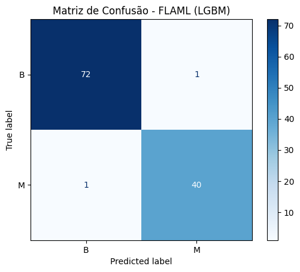
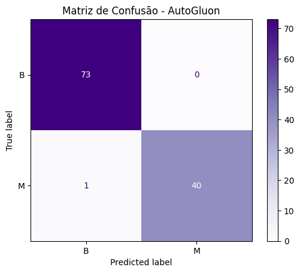
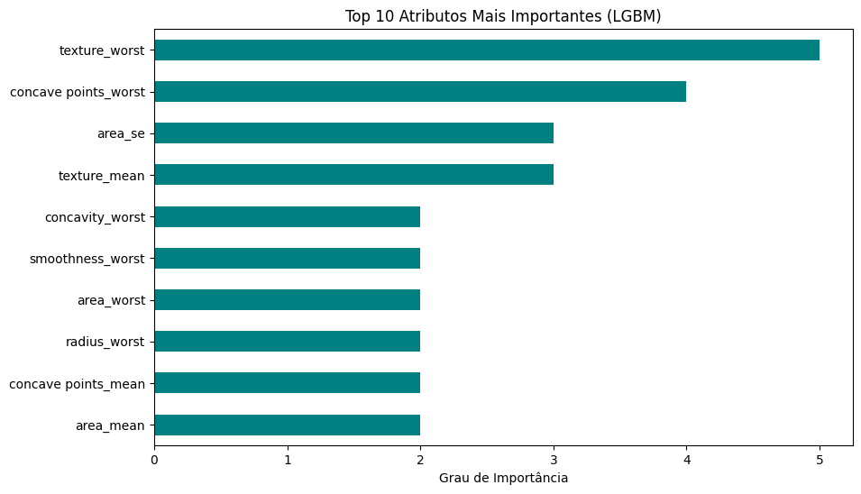
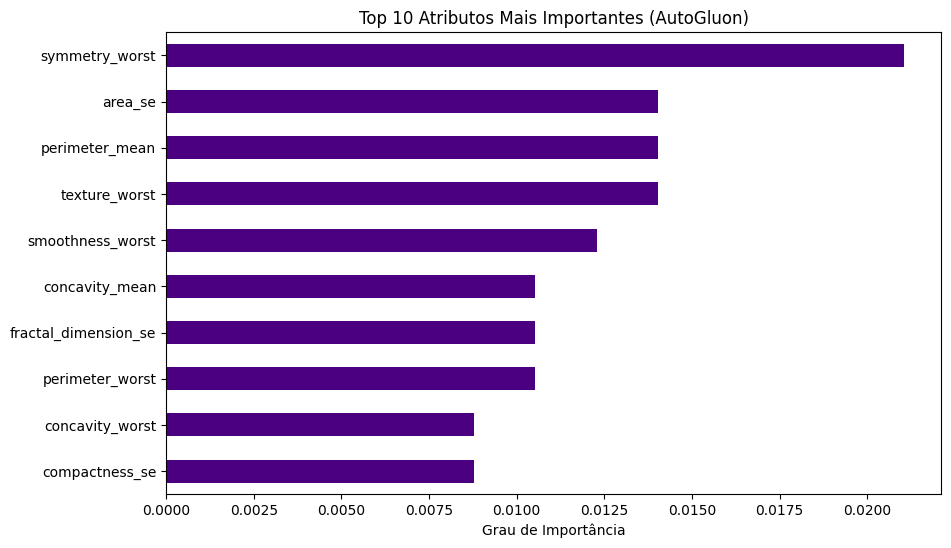

# Classificação de câncer de mama com AutoML: FLAML e AutoGluon

Estudo acadêmico de classificação supervisionada com **Python**, comparando as bibliotecas **FLAML** e **AutoGluon** em um mesmo conjunto de teste. O objetivo é praticar preparação de dados, treinamento automatizado, análise de métricas e interpretação de resultados.

> **Uso educacional.** Este repositório não desenvolve nem valida um sistema de diagnóstico médico. As métricas obtidas neste dataset não justificam uso clínico.

## Visão geral

Foi utilizado o conjunto público **Breast Cancer Wisconsin (Diagnostic)**, com **569 observações e 30 atributos numéricos** extraídos de imagens de amostras celulares. A tarefa consiste em classificar os registros como benignos (`B`) ou malignos (`M`).

O trabalho inclui:

- inspeção das dimensões, tipos de dados, distribuição das classes e valores ausentes;
- retirada das colunas auxiliares `id` e `Unnamed: 32` antes da modelagem;
- divisão treino/teste de **80% / 20%**, com `random_state=123`;
- execução do FLAML com até **50 iterações** de busca;
- treinamento de modelos tabulares com AutoGluon e inspeção do leaderboard;
- avaliação por acurácia, precisão, recall, F1 e matriz de confusão;
- exploração da importância dos atributos.

## Resultados da execução original

| Ferramenta | Modelo indicado na execução | Acurácia no teste | Acertos / amostras |
| --- | --- | ---: | ---: |
| FLAML | LightGBM (LGBM) | **98,25%** | 112 / 114 |
| AutoGluon | WeightedEnsemble_L2 | **99,12%** | 113 / 114 |

As métricas acima foram extraídas das saídas registradas no notebook original. Correspondem a **uma única divisão de dados** e não constituem uma comparação estatística abrangente. A diferença de uma classificação correta não permite concluir que uma biblioteca seja sistematicamente melhor. O conjunto de teste também não foi estratificado na implementação original.

### Matrizes de confusão

| FLAML | AutoGluon |
| --- | --- |
|  |  |

### Importância dos atributos

| FLAML | AutoGluon |
| --- | --- |
|  |  |

## Estrutura do repositório

```text
.
├── dados/
│   └── dataset_cancer.csv
├── imagens/
│   ├── flaml_matriz_confusao.png
│   ├── flaml_importancia_atributos.png
│   ├── autogluon_matriz_confusao.png
│   └── autogluon_importancia_atributos.png
├── notebooks/
│   └── comparacao_flaml_autogluon.ipynb
├── .gitignore
├── requirements.txt
└── README.md
```

**Não foram incluídos** modelos serializados (`.pkl`), checkpoints, logs e caches. Os notebooks publicados têm suas saídas de execução removidas; as figuras preservadas pertencem ao experimento principal.

## Como executar

Recomenda-se Python 3.10 ou 3.11 em um ambiente virtual. No Windows, a documentação do AutoGluon recomenda criar um ambiente pelo Anaconda/Miniconda se houver dificuldades com dependências.

```bash
python -m venv .venv
```

Ative o ambiente (no PowerShell: `.venv\Scripts\Activate.ps1`; em Linux/macOS: `source .venv/bin/activate`) e execute:

```bash
python -m pip install --upgrade pip
python -m pip install -r requirements.txt
jupyter lab
```

Abra `notebooks/comparacao_flaml_autogluon.ipynb`. **Inicie o Jupyter a partir da raiz do repositório** para que os caminhos relativos funcionem. O AutoGluon salva artefatos em `modelos/` e o FLAML gera logs em `logs/`, ambos ignorados pelo Git.

**Limitação de reprodutibilidade:** a instalação e a execução do experimento **não foram validadas novamente** na preparação deste repositório. Dependências e ambiente podem provocar resultados diferentes dos registros originais.

## Origem e licença do dataset

**Fonte:** Wolberg, W., Mangasarian, O., Street, N., & Street, W. (1993). *Breast Cancer Wisconsin (Diagnostic)*. UCI Machine Learning Repository. https://doi.org/10.24432/C5DW2B

O dataset é distribuído pelo UCI Machine Learning Repository sob a licença [Creative Commons Attribution 4.0 International (CC BY 4.0)](https://creativecommons.org/licenses/by/4.0/). A cópia em `dados/` foi mantida para permitir a reprodução da atividade, com a devida atribuição. O código e a análise deste repositório são apresentados como exercício acadêmico.

## Melhorias futuras

- Repetir a avaliação com validação cruzada estratificada e mais de uma semente aleatória.
- Comparar resultados com métricas específicas para a classe maligna (recall, precisão e F1).
- Registrar configurações e dependências em um ambiente reproduzível.
- Separar otimização de hiperparâmetros e avaliação final para evitar viés na seleção de modelos.
